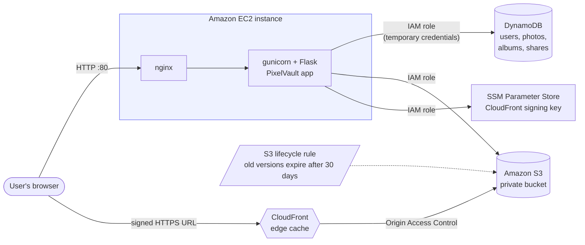
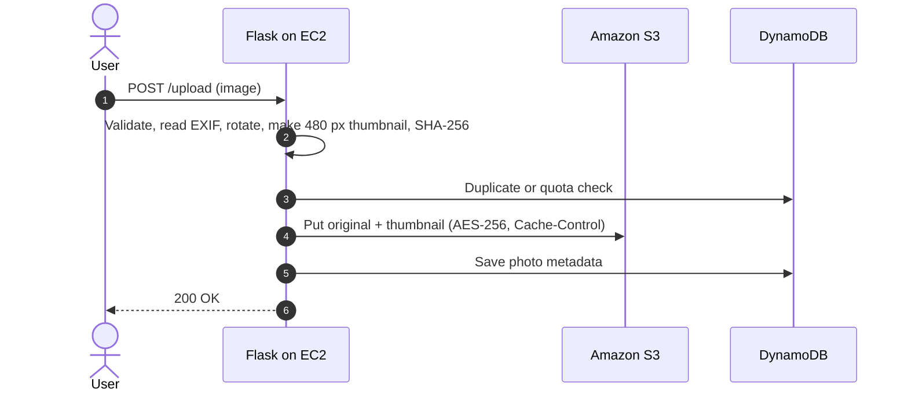
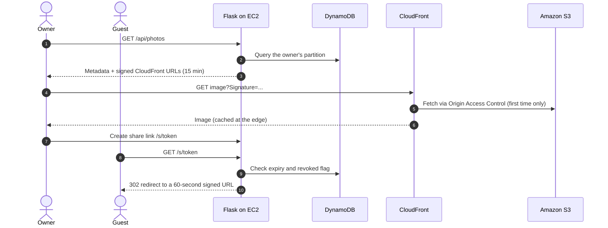

<p align="center">
  
</p>

<p align="center"><b>A private, multi-user photo library on AWS - Google Photos-style, built with Flask, DynamoDB, S3 and CloudFront.</b></p>

<p align="center">
  
  
  
  
  
</p>

> Cloud Computing SA project - **Samudyatha K Bhat** (24UG00225), BCA 5th semester, School of Engineering, Chanakya University.

---

## Table of contents
1. [Features](#features) · 2. [Architecture](#architecture) · 3. [AWS services](#aws-services-used) · 4. [Data model](#data-model-dynamodb-single-table) · 5. [Security](#security-design) · 6. [Project structure](#project-structure) · 7. [Configuration](#configuration) · 8. [Deploy on AWS](#deploy-on-aws) · 9. [Admin commands](#admin-commands) · 10. [Roadmap](#roadmap) · 11. [Author](#author)

## Features

| | Feature | What it does |
|---|---|---|
| 👤 | **Accounts** | Register and sign in; passwords stored only as salted hashes; lock-out after 5 failed attempts; optional invite code. |
| 🗓️ | **Timeline** | Photos grouped by the date they were *taken* (read from EXIF), with Today / Yesterday headings. |
| ⚡ | **Fast thumbnails** | A 480 px thumbnail is generated on upload, so the grid loads small files, not full originals. |
| ⭐ | **Favorites, albums, search** | Star photos, build albums, search by file name or camera model, sort by date / name / size. |
| ✅ | **Multi-select** | Select photos, whole days, or everything (Ctrl+A) and favorite, album or trash them in one go. |
| 🗑️ | **Trash with undo** | Soft delete, 30-day restore window, automatic clean-up; permanent delete also removes the S3 objects. |
| 🔗 | **Revocable share links** | Links with 1 hour to 7 day expiry, a view counter and instant revoke. |
| 🧬 | **Duplicate detection** | SHA-256 hash per photo - the same picture is never stored twice. |
| 📊 | **Per-user quotas** | 50 photos and 100 MB per account; usage meter in the sidebar. |
| 🌗 | **Modern UI** | Responsive layout, dark mode, drag-and-drop upload anywhere on the page. |

## Architecture



### Upload flow



### Viewing and sharing



## AWS services used

| Service | Role in PixelVault |
|---|---|
| **EC2** | Runs nginx and the Flask app (gunicorn). |
| **S3** | Private, encrypted, versioned storage for originals and thumbnails, one folder per user. |
| **DynamoDB** | Single-table store for users, photo metadata, albums and share links; TTL removes expired links. |
| **CloudFront** | CDN with signed URLs; the bucket is reachable only through an Origin Access Control. |
| **IAM** | Instance role with least-privilege policies - no access keys stored on the server. |
| **SSM Parameter Store** | Holds the CloudFront private key as a SecureString. |
| **S3 lifecycle** | Expires non-current object versions after 30 days to control cost. |

## Data model (DynamoDB single table)

| PK | SK | Holds |
|---|---|---|
| `USER#<id>` | `PROFILE` | username, password hash, lock-out state |
| `USER#<id>` | `IMG#<image-id>` | name, size, EXIF date, camera, hash, S3 keys, favorite, deleted_at |
| `USER#<id>` | `ALB#<album-id>` | album name and the set of photo ids |
| `USER#<id>` | `SHR#<image-id>#<token>` | expiry, views, revoked flag, `ttl` |
| `USERNAME#<name>` | `CLAIM` | guarantees unique usernames (conditional write) |
| `SHARE#<token>` | `POINTER` | lets the public `/s/<token>` link find its owner |

## Security design
- **No stored AWS keys** - the EC2 role supplies temporary credentials.
- **Least privilege** - the role can only read, write and delete under `images/*` and use one DynamoDB table.
- **Private bucket** - Block Public Access, AES-256 encryption, HTTPS-only policy, CloudFront-only reads.
- **Per-user isolation** - every request derives the user from the session; ownership is checked for each id in bulk actions.
- **Web hardening** - CSRF tokens, strict Content-Security-Policy, secure headers, hashed passwords, brute-force lock-out, image re-validation with Pillow, decompression-bomb limit.
- **Revocable sharing** - links are checked in the database on every click.

## Project structure

```
PixelVault/
├── app.py                  Flask app: auth, JSON API, admin CLI
├── store.py                DynamoDB data layer (single-table design)
├── cdn.py                  CloudFront signed-URL generator
├── templates/              index (library), login, register, icon sprite
├── static/                 app.js, style.css, v3.css, theme.js, logo.svg
├── policies/               IAM role policy, bucket policy, group policy
├── infra/                  lifecycle.json, DynamoDB script, step-by-step AWS setup (SETUP.md)
├── docs/                   logos and design notes (WHAT_CHANGED.md)
├── gallery.service         systemd unit
├── nginx-gallery.conf      reverse-proxy config
├── upgrade.sh              one-shot installer for the EC2 instance
└── requirements.txt
```

## Configuration

Set in `/etc/gallery.env` on the server.

| Variable | Default | Purpose |
|---|---|---|
| `S3_BUCKET` | *(required)* | Bucket name |
| `SECRET_KEY` | *(required)* | Flask session signing key |
| `AWS_REGION` | `ap-south-2` | Region for all services |
| `DDB_TABLE` | `PixelVault` | DynamoDB table name |
| `CDN_DOMAIN` / `CDN_KEY_PAIR_ID` | *(empty = CDN off)* | CloudFront domain and public-key ID |
| `CDN_KEY_PARAM` | `/pixelvault/cloudfront-private-key` | SSM parameter holding the private key |
| `REGISTRATION_OPEN` / `INVITE_CODE` | `true` / empty | Open sign-up, or require an invite word |
| `TRASH_DAYS` | `30` | Days before Trash empties itself |
| `MAX_UPLOAD_MB` / `MAX_IMAGES_PER_USER` / `MAX_STORAGE_MB_PER_USER` | `5` / `50` / `100` | Upload and quota limits |
| `APP_USERNAME` / `APP_PASSWORD` | `admin` / empty | Optional seeded admin account |
| `COOKIE_SECURE` | `false` | Set `true` once the site is served over HTTPS |

## Deploy on AWS

1. **Phase 1 - S3 lifecycle rule** and **Phase 2 - DynamoDB table plus IAM policy**: follow [`infra/SETUP.md`](infra/SETUP.md).
2. Copy `upgrade.sh` to the instance (for example through S3 and `aws s3 cp`) and run:
   ```bash
   INVITE_CODE='your-secret-word' bash upgrade.sh
   ```
   It checks the table, backs up the old files, migrates existing data, restarts the service and prints a health check.
3. **Phase 3 - CloudFront** (optional but recommended): follow `infra/SETUP.md`, then add `CDN_DOMAIN` and `CDN_KEY_PAIR_ID` to `/etc/gallery.env` and restart. `/health` should report `"cdn": true`.

> Stop the instance when you are not using it and set a billing alert. The public IPv4 address changes after every stop and start.

## Admin commands

Run inside `/opt/gallery` after loading the environment (`set -a; source <(sudo cat /etc/gallery.env); set +a`):

```bash
venv/bin/flask --app app adopt-legacy admin     # move pre-accounts images into the admin user
venv/bin/flask --app app backfill               # thumbnails, EXIF and hashes for older photos
venv/bin/flask --app app migrate-sqlite         # one-time copy from the old SQLite database
```

## Roadmap
- HTTPS with ACM and an Application Load Balancer
- Thumbnail generation with an S3 event and Lambda
- Content search with Amazon Rekognition
- Monitoring with CloudWatch alarms and AWS Budgets
- Infrastructure as code (CloudFormation or Terraform)

## Author

**Samudyatha K Bhat** - BCA, 5th semester · Reg. no. **24UG00225**
School of Engineering, Chanakya University · Cloud Computing SA project

*Educational project. Add a `LICENSE` file before reusing the code elsewhere.*
